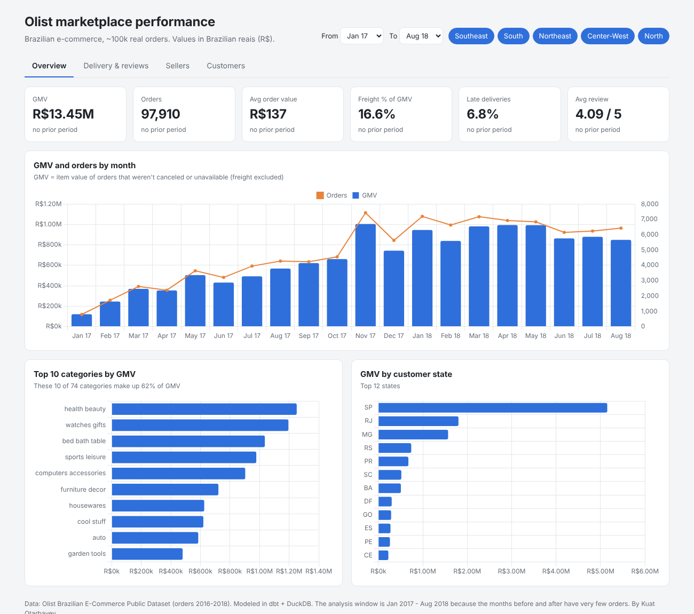
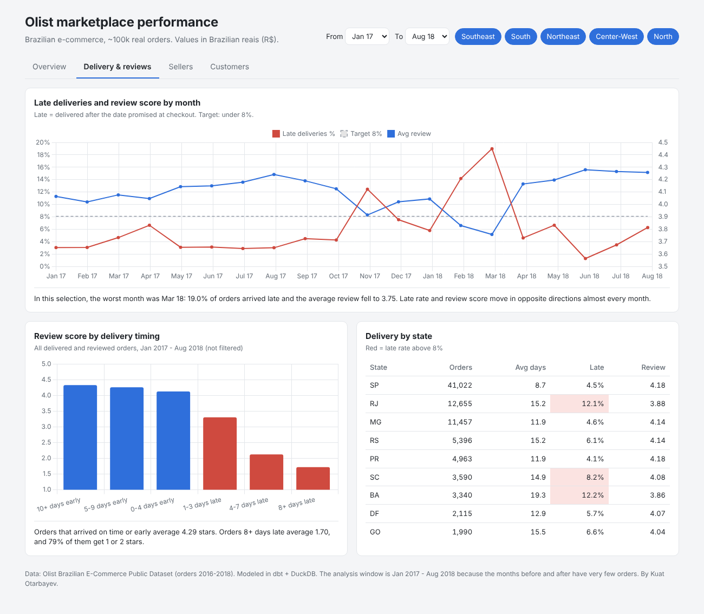
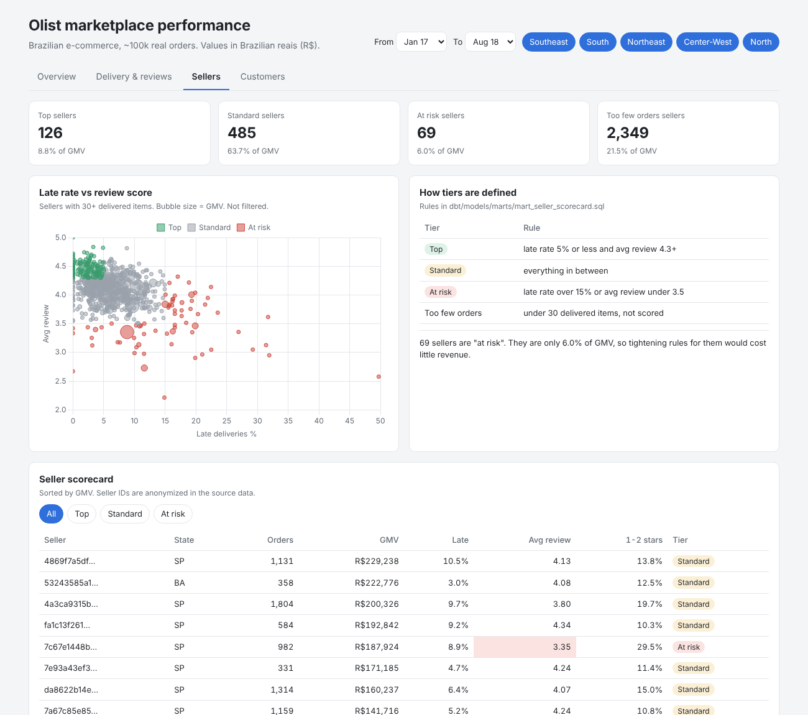
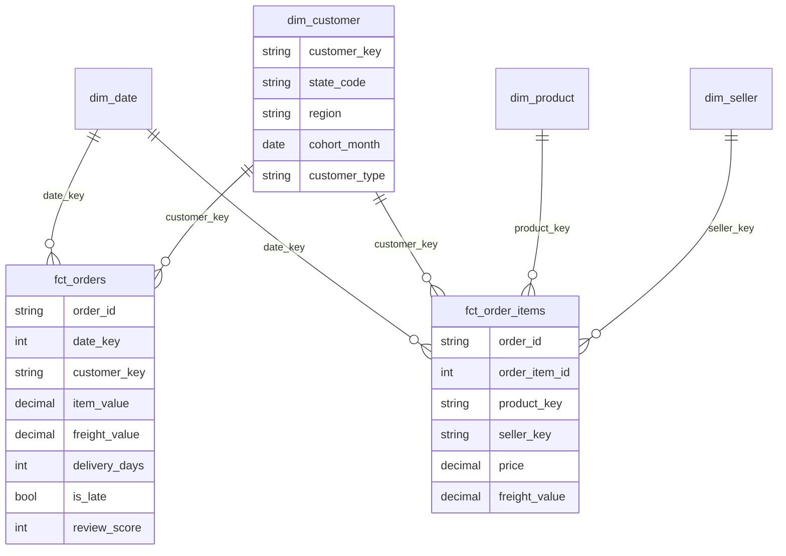

# Olist e-commerce BI


**Live dashboard: [kuat-oss.github.io/olist-ecommerce-bi](https://kuat-oss.github.io/olist-ecommerce-bi/)**

A BI project on real marketplace data: about 100,000 orders from Olist, a Brazilian e-commerce marketplace that released anonymized order data from 2016-2018. I built a star schema in dbt, defined the KPIs once, and used them in a web dashboard and a Power BI report.

The question I tried to answer is the one an operations or marketplace manager would ask: **what is hurting customer satisfaction, and what should we fix first?**



## What I found

**Late delivery is the main driver of bad reviews.** Only 6.7% of delivered orders arrived after the promised date, but those orders produced 32% of all 1-2 star reviews. Orders that arrived on time average 4.3 stars. Orders 8+ days late average 1.7, and 79% of them get 1 or 2 stars. If late orders had been rated like on-time ones, the average rating of delivered orders would go from 4.16 to 4.29.

**The operation broke after Black Friday 2017.** Orders jumped 63% in November 2017. The late rate rose to 12% that month, and in Feb-Mar 2018 it reached 14-19%, with the average review dropping to 3.75. Both recovered by April. Peak season planning (carrier capacity, seller stock) is the obvious lesson.

**Delivery promises are very padded, but the Northeast still misses them.** The median order was promised in 24 days and arrived in 10. Even so, customers in the Northeast get 13.7% of orders late, compared with 8.0% in the Southeast and 6.1% in the South. Alagoas (21.5%) and Maranhao (17.5%) are the worst states. Freight there is 38-54% of the item price, compared with 25% in Sao Paulo.

**Almost nobody comes back.** 97% of customers ordered only once. Only about 0.5% of new customers order again the following month. Repeat customers spend R$260 on average vs R$138 for one-time buyers, so even a small improvement in repeat purchases is worth a lot.

**A small group of sellers causes a lot of the damage.** 69 sellers are "at risk" (late over 15% or average review under 3.5). They bring in only 6% of GMV, and 30% of their orders get 1-2 stars. 

**Revenue is concentrated.** 17 of 74 product categories make up 80% of GMV. Health & beauty, watches & gifts and bed & bath are the top three.

Overall: R$13.4M GMV from 97,910 orders between Jan 2017 and Aug 2018. GMV in Jan-Aug 2018 was 2.4x the same months of 2017.

## What I would do

1. **Treat on-time delivery as the main quality KPI** and track it weekly next to review score. A target of under 8% late would have flagged Nov 2017 and Feb-Mar 2018 immediately.
2. **Put the 69 at-risk sellers on an improvement plan** (shipping deadlines, lower search ranking if they don't improve). That risks about 6% of GMV, but addresses a large share of 1-2 star reviews.
3. **Plan for peak season.** Add carrier capacity and set realistic delivery estimates for Nov-Mar, when the late rate jumped.
4. **Fix delivery to the Northeast**, for example regional carriers or sellers closer to those customers. This region is 9% of orders but has the highest late rate and freight cost.
5. **Test a second-purchase campaign.** With 97% one-time buyers, a coupon or email after the first delivery is cheap to test. Measure it with the cohort table.

## Dashboard

The web dashboard has four pages: overview, delivery & reviews, sellers and customers. You can filter by period and customer region, and KPI cards compare with the previous period of the same length.

| Delivery & reviews | Sellers |
|---|---|
|  |  |

There is also a Power BI version of the report (see [powerbi/](powerbi/)), built on the same star schema and with the same measures.

## Data model



Two fact tables at different grains (order and order item) share the same dimensions. Reviews and delivery live on the order, sellers and products on the item.

```
data/raw/            original Olist csv files (gzipped)
dbt/
  models/staging/    clean names and types, dedupe reviews, translate categories
  models/intermediate/ int_orders: one row per order with payments, delivery and review
  models/marts/      dim_* and fct_* (star schema) + mart_* tables for each KPI view
  seeds/             Brazilian states and regions
  tests/             reconciliation tests
powerbi/             star schema as parquet, DAX measures, build guide, expected values
dashboard/           web dashboard (Chart.js)
scripts/             export to Power BI, build dashboard data
docs/                metric definitions, screenshots
```

KPI definitions are written down once in [docs/metric_definitions.md](docs/metric_definitions.md).

## Data quality

The source data has real problems. Each one is handled in dbt and covered by a test (67 models and tests in total).

| Problem | Rows | What I did |
|---|---:|---|
| Extra reviews on orders that were reviewed more than once | 551 | Kept the most recent review per order |
| Products with no category | 610 | Labeled `unknown` |
| Categories missing from the translation file | 2 | Used the Portuguese name |
| `customer_id` is new for every order | 99,441 ids for 96,096 people | Used `customer_unique_id` as the customer key |
| Orders with no items (canceled, unavailable) | 775 | Kept in orders, excluded from GMV |
| Delivered orders with no delivery date | 8 | Not counted as delivered |
| Very few orders before 2017 and after Aug 2018 | ~350 | KPIs use Jan 2017 - Aug 2018 |
| Typos in source columns (`product_name_lenght`) | | Renamed in staging |

Reconciliation tests check that every raw order item lands in the fact table once, that order GMV equals the sum of its items, and that payments match order value for at least 95% of orders (vouchers and installment fees explain the rest).

## Run it

```bash
pip install -r requirements.txt
make build      # dbt build: models + tests
make exports    # parquet files for Power BI + dashboard data
make serve      # dashboard on http://localhost:8000/dashboard/
```

## Data source

[Olist Brazilian E-Commerce Public Dataset](https://github.com/olist/work-at-olist-data), released by Olist under CC BY-NC-SA 4.0. Company and partner names in the reviews were replaced by the publisher, and seller and customer IDs are anonymized.

## Limitations

- The data stops in Aug 2018, so this describes that period, not Olist today.
- I can see that late orders get bad reviews, but not whether bad reviews cause lost sales. That would need traffic or conversion data.
- Delivery estimates come from the platform. I don't know how they were calculated, only how often they were met.
- Retention is measured within a 20-month window, so later cohorts have less time to come back.

Kuat Otarbayev
